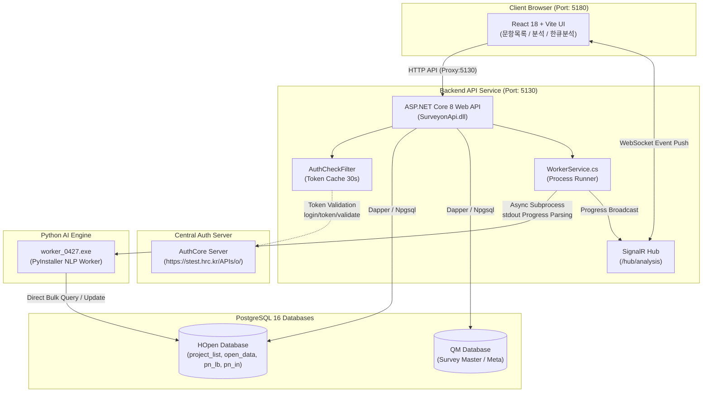

# 설문온 AI오픈(AI Open Analysis) 모듈 인수인계 및 운영 가이드

> **문서 버전**: v1.0.0  
> **최종 수정일**: 2026-11-09  
> **프로젝트 루트**: `D:\python\Antigravity\(261109)설문온_AIOPEN`  
> **담당 업무**: 설문온 주관식 문항 목록 관리, AI 자동 분석(보기분석/응답자분석/한큐분석), PID별 데이터 및 통계 뷰어

---

## 1. 시스템 개요 및 비즈니스 목적

본 프로젝트는 **설문온(Surveyon)** 플랫폼의 대규모 주관식(오픈엔드) 설문 응답 데이터를 자연어 처리(NLP) 및 AI 모델을 활용해 자동으로 범주화(대/중/소 분류)하고, 실시간 통계 및 분석 리포트를 제공하는 독립 모듈입니다.

기존 APICORE 모놀리스 프로젝트에서 **AI오픈 핵심 기능(`문항목록`, `분석 페이지`, `한큐분석`)**을 완전히 분리하여 독립적인 백엔드(`API`)와 프론트엔드(`UI`)로 패키징하였으며, 신규 담당자가 빠르고 안전하게 개발 및 운영 환경을 구축할 수 있도록 구성되었습니다.

### 핵심 비즈니스 파이프라인
1. **문항 목록 관리 (`/pro_list`, `/project`)**:
   - 프로젝트 내 주관식 문항 탐색, 문항 통합/분리 관리.
   - 문항별 분석 진행 상태 조회 및 분석 옵션(`option_json`) 설정.
   - 프로젝트 단위 범용 분석 옵션(`option_json_all`) 설정 (한큐분석 공통 적용).
2. **AI 오픈 자동 분석 파이프라인 (`/analysis`)**:
   - **1단계: 보기분석**: 응답 데이터 클러스터링을 통한 대/중/소 범주(코드북) 자동 생성.
   - **2단계: 응답자분석(전체)**: 생성된 범주에 따라 전체 응답자를 대/중/소 코드로 자동 분류.
   - **3단계: 응답자분석(빈셀)**: 미분류 응답 또는 빈셀 응답에 대한 정밀 재분류.
   - **한큐분석 (One-Click Pipeline)**:
     - 문항 목록 화면에서 원클릭으로 모든 대상 문항에 대해 [보기분석 → 응답자(전체) → 응답자(빈셀)]를 순차/병렬 자동 실행.
     - SignalR 웹소켓을 통한 실시간 진행률(Progress %) 및 예상 소요시간 브로드캐스트.
3. **분석 데이터 뷰어 & 통계**:
   - **보기 데이터**: 계층형 트리(대분류, 중분류, 소분류), 빈도/비율 통계, 보기 수동 편집/추가/삭제.
   - **응답 데이터**: 응답자별 원문 텍스트, 분류 결과 그리드, 헤더 틀고정 및 열별 다이나믹 정렬/필터.
   - **PID별 데이터**: 응답자 고유번호(PID) 기준 분류 이력, 소코드 빈도 계산 표기.
   - **번역 기능**: 다국어 응답 텍스트에 대한 자동 번역 워커 연동.

---

## 2. 전체 아키텍처 및 시스템 구성도



### 기술 스택 명세
| 영역 | 기술 스택 | 버전 / 도구 | 비고 |
| :--- | :--- | :--- | :--- |
| **Backend API** | ASP.NET Core Web API | .NET 8.0 (C# 12) | 비동기 파이프라인, Dapper ORM |
| **Realtime Push**| Microsoft.AspNetCore.SignalR | 8.0 | 실시간 한큐분석 진행 상태 스트리밍 |
| **Frontend UI** | React, Vite | React 18, Vite 5 | SPA, Tailwind CSS, Lucide Icons |
| **AI Worker** | Python PyInstaller Binary | worker_0427.exe (108MB) | `API/docs/legacy_src/` 내 영구 보존 |
| **Database** | PostgreSQL | PostgreSQL 16 | Npgsql 데이터베이스 공급자 |
| **인증 연동** | HTTP Token Validation | IMemoryCache (30s) | `X-Auth-Token`, `X-Internal-Key` |

---

## 3. 디렉토리 구조 명세

```
(261109)설문온_AIOPEN/
├── HANDOVER.md                     # [본 문서] 종합 인수인계 및 운영 가이드
│
├── API/                            # 백엔드 ASP.NET Core 8 프로젝트
│   ├── SurveyonApi.csproj          # C# 프로젝트 설정 파일
│   ├── Program.cs                  # 의존성 주입, 미들웨어, CORS, SignalR 매핑
│   ├── appsettings.json            # 기본 환경 설정 (DB 연결문자열, Auth 블록)
│   ├── appsettings.Development.json# 개발 환경 설정
│   ├── appsettings.Production.json # 운영 환경 설정
│   │
│   ├── Controllers/                # REST API 컨트롤러 (핵심 5대 모듈 + 토큰 관리)
│   │   ├── LoginController.cs      # 설문온 로그인/로그아웃 및 토큰 인증
│   │   ├── Pro_listController.cs   # 문항 목록, 진행상황, 범용 옵션(/option_all), 엑셀/DP
│   │   ├── Pro_registerController.cs # 문항 등록, 큐마 DB 연동 및 메타 관리
│   │   ├── ProjectController.cs    # 프로젝트 마스터, QM 연동 및 데이터 동기화
│   │   ├── AnalysisController.cs   # 문항 분석 상세 페이지 API (/analysis/*)
│   │   ├── BaseController.cs       # 공통 응답 처리 기본 컨트롤러
│   │   ├── TokenCostController.cs  # 토큰 비용 집계
│   │   └── TokenUseController.cs   # OpenAI 토큰 사용량/비용 조회
│   │
│   ├── Filters/
│   │   └── AuthCheckFilter.cs      # 외부 AuthCore 원격 토큰 검증 필터
│   │
│   ├── Infrastructure/
│   │   └── AuthOptions.cs          # Auth 설정 바인딩 모델 및 요청/응답 DTO
│   │
│   ├── Hubs/
│   │   └── WorkerHub.cs            # SignalR 실시간 워커 분석 로그 허브
│   │
│   ├── Services/
│   │   ├── WorkerService.cs        # worker_0427.exe 프로세스 기동 및 로그 파싱
│   │   └── ...
│   │
│   ├── Repositories/               # DB 쿼리 및 데이터 접근 계층
│   │   ├── MainRepository.cs       # HOpen / QM 데이터베이스 조회 및 갱신
│   │   └── ...
│   │
│   └── docs/
│       └── legacy_src/             # 레거시 파이썬 워커 소스 및 바이너리
│           ├── worker_0427.exe     # AI 분석 핵심 바이너리 (108MB)
│           ├── worker_0427.py      # 분석 워커 원본 파이썬 소스
│           └── ...
│
└── UI/                             # 프론트엔드 React 18 + Vite 프로젝트
    ├── package.json                # npm 의존성 정의
    ├── vite.config.js              # Vite 설정 (로컬 포트: 5180, 프록시: 5130)
    ├── index.html                  # 싱글 페이지 엔트리포인트
    ├── src/
    │   ├── App.jsx                 # 메인 라우터 및 상태 관리
    │   ├── components/             # 공통 UI 컴포넌트
    │   │   ├── Header.jsx          # 네비게이션 헤더
    │   │   ├── OneClickModal.jsx   # 한큐분석 범용 옵션 모달
    │   │   └── ...
    │   ├── pages/
    │   │   ├── QuestionList.jsx    # 문항 목록 화면 (한큐분석 트리거)
    │   │   ├── AnalysisView.jsx    # 문항 분석 화면 (보기/응답/PID별 탭)
    │   │   └── ...
    │   └── services/               # API 및 SignalR 연동 서비스
```

---

## 4. 인증 및 보안 아키텍처

본 모듈은 독립 마이크로서비스로 동작하므로, 자체적으로 토큰을 발급하지 않고 **중앙 인증 서버(`AuthCore`)에 토큰 유효성을 조회**하는 방식을 사용합니다.

### 4.1. `appsettings.json` 설정 규격
```json
"Auth": {
  "AuthCoreBaseUrl": "https://stest.hrc.kr/APIs/o/",
  "ValidatePath": "login/token/validate",
  "HeaderName": "X-Auth-Token",
  "CacheSeconds": 30,
  "DisableAuth": false,
  "InternalKey": "cGZeWyxlli5N4FRSwMAsbbRoNzJEhFkocore",
  "InternalKeyHeaderName": "X-Internal-Key"
}
```

### 4.2. 인증 필터 (`AuthCheckFilter.cs`) 동작 흐름
1. **`DisableAuth == true` 검사**:
   - 로컬 개발 환경이나 테스트 시 인증을 생략해야 할 경우, 설정값을 `true`로 변경하면 모든 검증을 즉시 통과합니다.
2. **내부 통신용 Key 검사 (`X-Internal-Key`)**:
   - 마이크로서비스 간(Server-to-Server) 배치 또는 스케줄러 호출 시 `InternalKey`가 일치하면 토큰 검증 없이 즉시 허용됩니다.
3. **토큰 캐시 확인 (`IMemoryCache`)**:
   - 클라이언트가 전달한 `X-Auth-Token`을 캐시 키로 조회하여, 최근 30초 이내에 성공 검증된 토큰이면 원격 호출 없이 즉시 통과합니다.
4. **원격 AuthCore 검증 API 호출**:
   - 캐시에 없을 경우 `POST {AuthCoreBaseUrl}/{ValidatePath}`를 호출합니다.
   - Request Body: `{"token": "..."}`
   - 응답이 성공(`isValid: true`)이면 결과를 `CacheSeconds`(30초) 동안 캐시에 저장하고 요청을 컨트롤러로 전달합니다.
   - 응답 실패 시 `401 Unauthorized` (`ErrorCode: 1001/1002`)를 반환합니다.

---

## 5. 데이터베이스 스키마 및 핵심 테이블 명세

본 시스템은 PostgreSQL 16 기반의 `HOpen` 데이터베이스를 주 저장소로 사용합니다.

### 5.1. `project_list` (프로젝트 및 문항 마스터)
| 컬럼명 | 타입 | 설명 |
| :--- | :--- | :--- |
| `pid` | VARCHAR | 프로젝트 고유 ID |
| `qid` | VARCHAR | 문항 고유 식별자 |
| `qname` | VARCHAR | 문항명 / 설문 질문 텍스트 |
| `status` | VARCHAR | 분석 진행 상태 (`대기`, `보기분석중`, `완료` 등) |
| `option_json` | JSONB | 개별 문항별 AI 분석 옵션 (임계치, 클러스터 수 등) |
| `option_json_all` | JSONB | **한큐분석 전용 범용 분석 옵션** (프로젝트 전체 문항 공통 적용) |
| `reg_date` | TIMESTAMP | 등록 일시 |

### 5.2. `pn_lb` (대/중/소 범주 코드북)
| 컬럼명 | 타입 | 설명 |
| :--- | :--- | :--- |
| `pid` | VARCHAR | 프로젝트 ID |
| `qid` | VARCHAR | 문항 ID |
| `l_cd` | VARCHAR | 대분류 코드 |
| `l_nm` | VARCHAR | 대분류 명칭 |
| `m_cd` | VARCHAR | 중분류 코드 |
| `m_nm` | VARCHAR | 중분류 명칭 |
| `s_cd` | VARCHAR | 소분류 코드 (최하위 분류) |
| `s_nm` | VARCHAR | 소분류 명칭 |

### 5.3. `open_data` / `pn_in` (응답 원문 및 분류 결과)
| 컬럼명 | 타입 | 설명 |
| :--- | :--- | :--- |
| `pid` | VARCHAR | 프로젝트 ID |
| `qid` | VARCHAR | 문항 ID |
| `rid` / `pid_no` | VARCHAR | 응답자 고유 식별 번호 (PID) |
| `response_text`| TEXT | 주관식 원문 텍스트 |
| `s_cd` | VARCHAR | 매핑된 소분류 코드 |
| `is_classified`| BOOLEAN | 분류 완료 여부 (미분류/빈셀 판별용) |

---

## 6. AI 분석 엔진 (`worker_0427.exe`) 연동 규격

### 6.1. 바이너리 위치 및 배포 규칙
- 바이너리 파일: `API/docs/legacy_src/worker_0427.exe` (약 108MB)
- `WorkerService.cs`에서 다음 순서로 실행 파일을 탐색합니다:
  1. `AppContext.BaseDirectory/worker_0427.exe` (배포 폴더)
  2. `API/docs/legacy_src/worker_0427.exe` (프로젝트 소스 폴더)
  3. `D:\python\Antigravity\(261109)설문온_AIOPEN\API\docs\legacy_src\worker_0427.exe` (절대 경로 폴백)

### 6.2. 프로세스 실행 인자
`WorkerService.cs`는 서브프로세스를 다음과 같이 비동기 호출합니다:
```bash
worker_0427.exe --pid "<프로젝트ID>" --qid "<문항ID>" --mode "<step1|step2|step3>" --dbconn "<PostgreSqlConnectionString>" --options "<OptionJsonString>"
```
- stdout 스트림을 실시간 감지하여 `[PROGRESS: 45%]` 패턴을 파싱한 후 `AnalysisHub`를 통해 프론트엔드로 브로드캐스트합니다.

---

## 7. 로컬 개발 및 실행 가이드

### 7.1. 포트 구성 (포트 충돌 원천 방지)
- **API 포트**: `5130` (기존 APICORE 5120과 완전 분리)
- **UI 포트**: `5180` (기존 ClientTestUI 5173과 완전 분리)

### 7.2. API 백엔드 실행
```powershell
cd "D:\python\Antigravity\(261109)설문온_AIOPEN\API"

# 1. 의존성 복원 및 빌드 검증
dotnet build

# 2. 로컬 API 서버 기동 (http://localhost:5130)
dotnet run --launch-profile http
```

### 7.3. UI 프론트엔드 실행
```powershell
cd "D:\python\Antigravity\(261109)설문온_AIOPEN\UI"

# 1. 패키지 설치 (최초 1회)
npm install

# 2. 로컬 개발 서버 기동 (http://localhost:5180)
npm run dev

# 3. 운영 배포 빌드 검증
npm run build
```
- 브라우저에서 `http://localhost:5180` 접속 후 사용 가능합니다.
- `vite.config.js` 프록시를 통해 `/api` 및 `/hub` 요청이 자동으로 `http://127.0.0.1:5130`으로 전달됩니다.

---

## 8. 운영 및 트러블슈팅 FAQ

### Q1. UI 화면에서 "401 Unauthorized" 오류가 발생합니다.
- **원인**: 전달된 `X-Auth-Token`이 만료되었거나, 중앙 `AuthCoreBaseUrl` 서버(`https://stest.hrc.kr/APIs/o/`)에 도달할 수 없는 네트워크 상태입니다.
- **조치**:
  1. 로컬 개발 또는 기능 테스트 시에는 `API/appsettings.json`의 `"DisableAuth": true`로 변경하여 우회합니다.
  2. 운영 환경에서는 클라이언트 로그인 모듈에서 최신 토큰을 발급받아 헤더에 탑재하는지 점검합니다.

### Q2. 한큐분석 실행 시 워커 프로세스가 기동되지 않거나 오류가 납니다.
- **원인**: `worker_0427.exe` 파일이 존재하지 않거나, PostgreSQL 연결 정보가 잘못되었을 수 있습니다.
- **조치**:
  1. `API/docs/legacy_src/worker_0427.exe` 파일의 존재 및 파일 크기(약 108MB)를 확인합니다.
  2. `appsettings.json`의 `ConnectionStrings.HOpenDb` 연결 문자열에 명시된 DB 호스트, 포트, 패스워드를 검증합니다.

### Q3. 실시간 진행률이 화면에 업데이트되지 않습니다.
- **원인**: 브라우저와 API 간 SignalR 웹소켓 연결이 차단되었거나 프록시 설정이 어긋난 경우입니다.
- **조치**:
  1. `UI/vite.config.js`에 `ws: true` 옵션이 설정되어 있는지 확인합니다.
  2. 개발자 도구 Network 탭에서 `/hub/analysis`의 프로토콜이 `websocket`으로 정상 업그레이드되었는지 확인합니다.

---

## 9. 담당자 체크리스트

| 점검 항목 | 확인 명령 / 확인 경로 | 완료 여부 |
| :--- | :--- | :---: |
| API 빌드 무결성 | `cd API && dotnet build` (0 Errors) | ✅ |
| UI 빌드 무결성 | `cd UI && npm run build` (0 Errors) | ✅ |
| 108MB 워커 바이너리 | `API/docs/legacy_src/worker_0427.exe` 존재 확인 | ✅ |
| 포트 충돌 방지 | API(5130), UI(5180) 독립 지정 확인 | ✅ |
| 외부 토큰 검증 연동 | `AuthCheckFilter.cs` & `AuthOptions.cs` 적용 확인 | ✅ |
| 범용 옵션 한큐분석 | `Pro_listController.cs` (`/option_all`) 구현 확인 | ✅ |
